<div align="center">


# Ayam Gepuk-In

### *Gepuk-Nya Nagih!* 🌶️

Landing page interaktif untuk UMKM kuliner **Ayam Gepuk-In** (sejak 2022) di Vida Bumipala, Kota Bekasi.
Pengunjung bisa lihat menu, isi keranjang, lalu **pesan langsung lewat WhatsApp**.


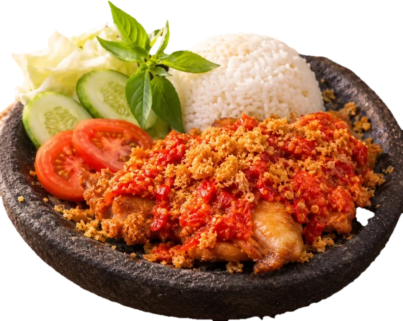

</div>

---

## ✨ Fitur Utama

| | Fitur | Keterangan |
|---|---|---|
| 🛒 | **Keranjang belanja** | Tambah/kurangi item, total otomatis, tersimpan di `localStorage` |
| 💬 | **Checkout ke WhatsApp** | Isi keranjang + nama + catatan otomatis jadi pesan WA siap kirim |
| 🍗 | **Toggle Paket / Ala Carte** | Harga menu langsung berganti sesuai pilihan |
| 🌶️ | **Sambal & Tepung kemasan** | 5 varian sambal 250gr + Tepung Gepuk-in |
| 🎉 | **Catering** | Galeri bukti pesanan 50 sampai 90 porsi + CTA WA dengan template pesan |
| 🕒 | **Status Buka/Tutup real-time** | Dihitung dari jam operasional 08.00 sampai 22.00 |
| 🎵 | **Musik latar** | Bisa dinyalakan/dimatikan pengunjung |
| 🎞️ | **Animasi scroll** | Elemen muncul halus memakai `IntersectionObserver` |
| 📱 | **Responsif** | Didesain mobile-first, karena kebanyakan trafik datang dari Instagram |
| ✅ | **Label Halal** | Logo halal resmi untuk membangun kepercayaan |

## 🍽️ Menu

<div align="center">

| <br>**Ayam Gepuk** | 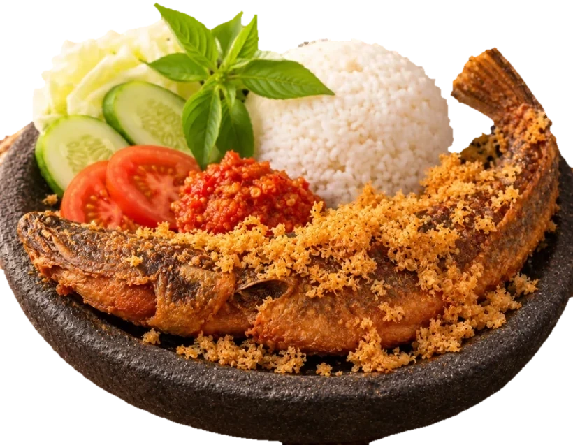<br>**Lele Kriuk** | 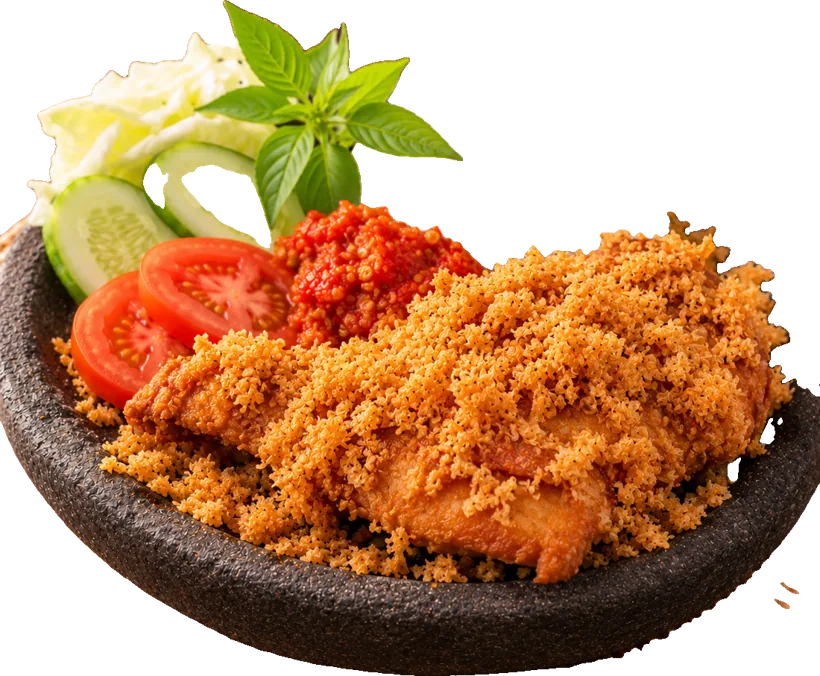<br>**Kremes Bawang** | 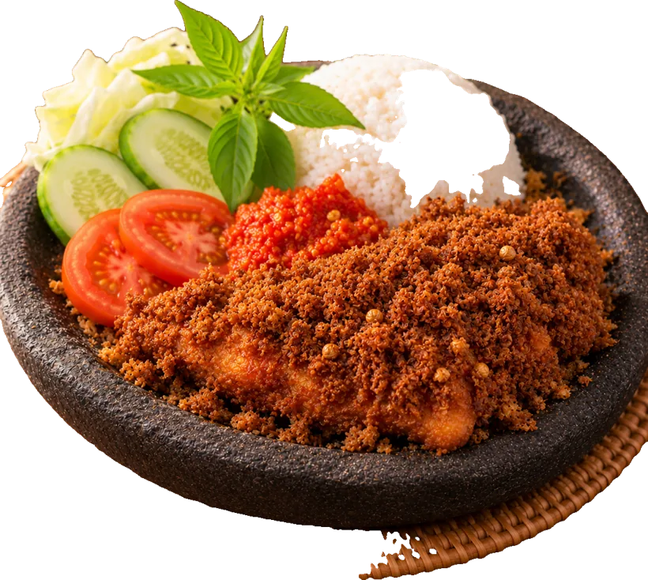<br>**Kremes Ketumbar** |
|:---:|:---:|:---:|:---:|
| 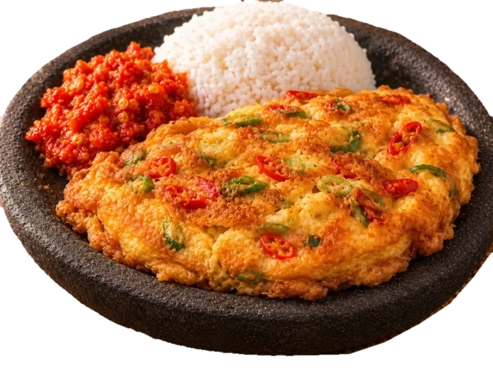<br>**Telur Dadar Cabe Rawit** | <br>**Tahu Ngebul** | <br>**Tempe Selimut** | 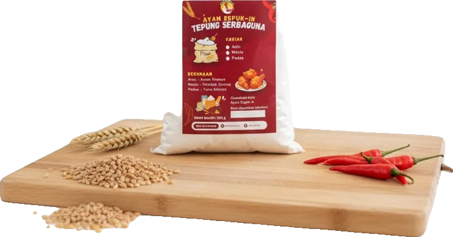<br>**Tepung Gepuk-in** |

**Sambal 250gr**

| 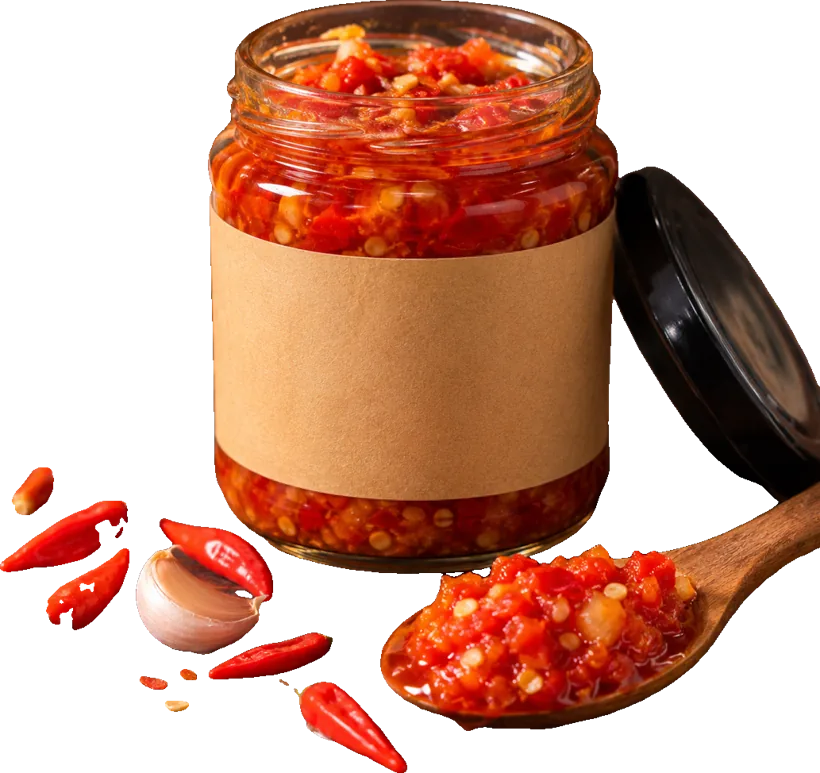<br>Bawang Segar | 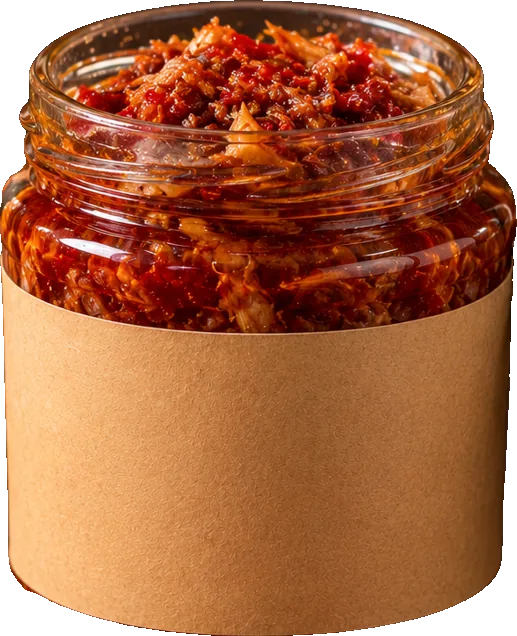<br>Cakalang | 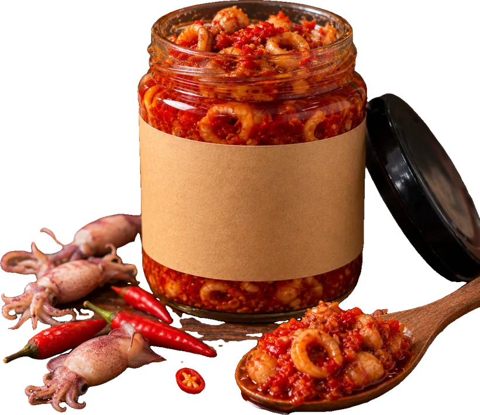<br>Cumi | 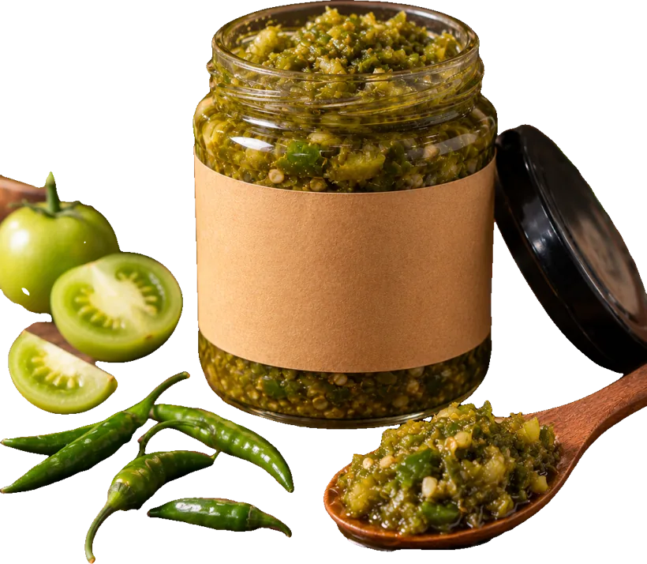<br>Ijo Royo-royo | 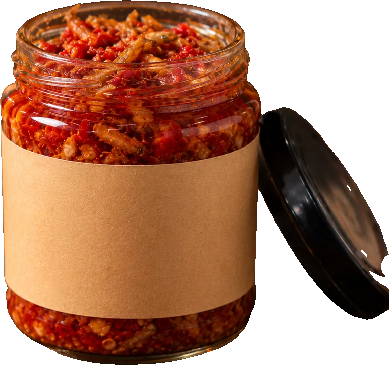<br>Teri |
|:---:|:---:|:---:|:---:|:---:|

</div>

## 📸 Dokumentasi Catering

<div align="center">
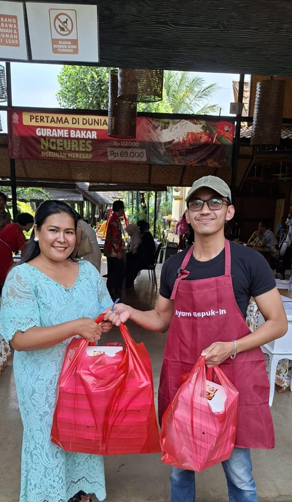
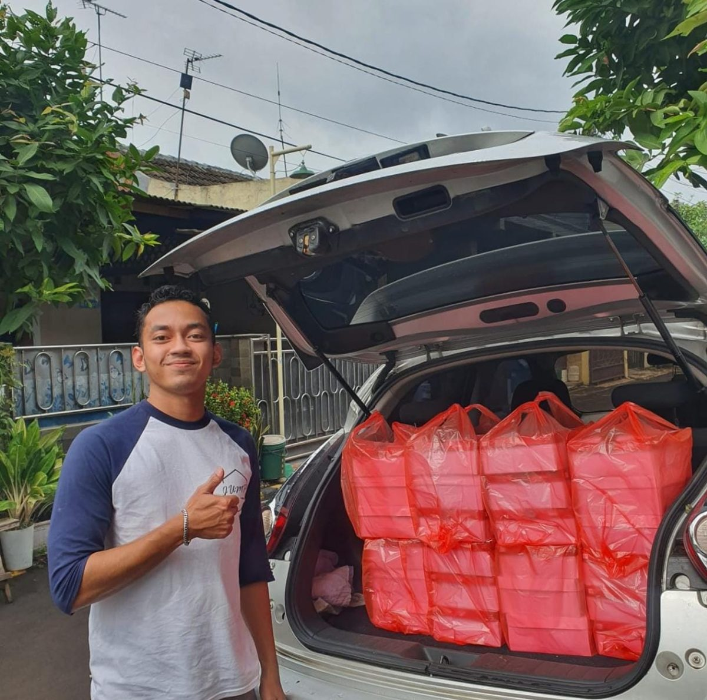
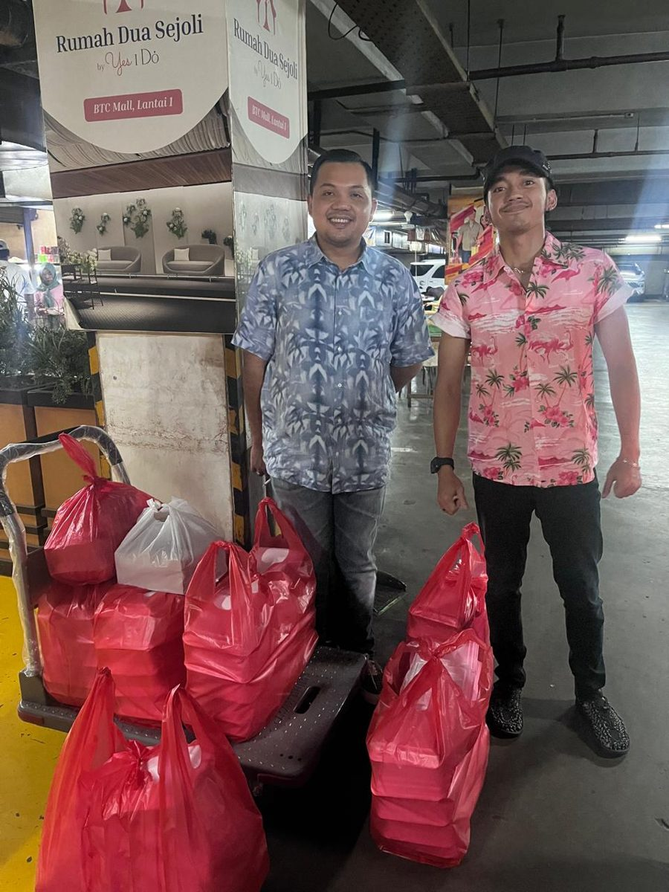
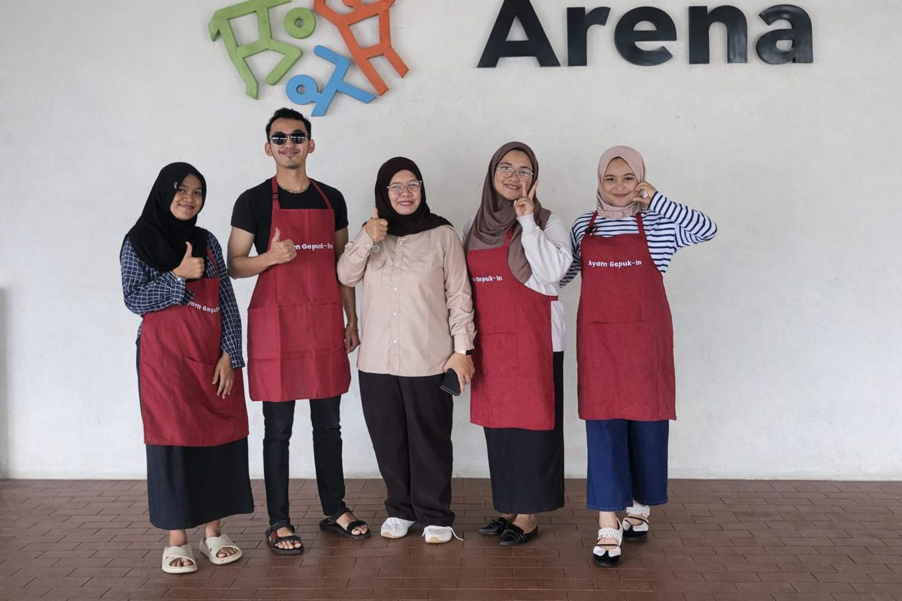
</div>

## 🎨 Identitas Visual

| Warna | Hex | Peran |
|---|---|---|
|  Maroon | `#8E1B1F` | Warna utama brand |
|  Kuning | `#F7B500` | Aksen dan CTA |
|  Krem | `#FFF6E6` | Latar hangat |

Palet warna diambil dari logo dan feed Instagram Ayam Gepuk-In.

## 🗂️ Struktur Proyek

```
AyamGepuk-Web/
├── index.html          # Halaman utama (satu halaman)
├── css/
│   └── style.css       # Seluruh styling + animasi
├── js/
│   ├── data.js         # Data menu, harga, sambal, produk "Segera Hadir"
│   └── main.js         # Keranjang, checkout WA, toggle harga, status buka, animasi
├── assets/
│   ├── img/            # Logo, foto menu (webp), dokumentasi
│   └── lagu/           # Musik latar
└── PRD.md              # Dokumen kebutuhan produk
```

## 🚀 Cara Menjalankan

Tidak perlu install apa pun karena proyek ini memakai HTML, CSS, dan JS murni.

```bash
git clone https://github.com/Naufal-Ghani22/AyamGepuk-Web.git
cd AyamGepuk-Web
# buka index.html langsung di browser, atau jalankan server lokal:
npx serve .
```

> 💡 Untuk mengubah menu atau harga, cukup edit `js/data.js`.

## 📄 Dokumentasi

Kebutuhan produk lengkap (tujuan, target pengguna, struktur section, data menu) ada di [`PRD.md`](PRD.md).

---

<div align="center">

📍 **Vida Bumipala, Kota Bekasi** · 🕗 Buka 08.00 sampai 22.00

Dibuat dengan ❤️ dan 🌶️ untuk **Ayam Gepuk-In**

</div>
