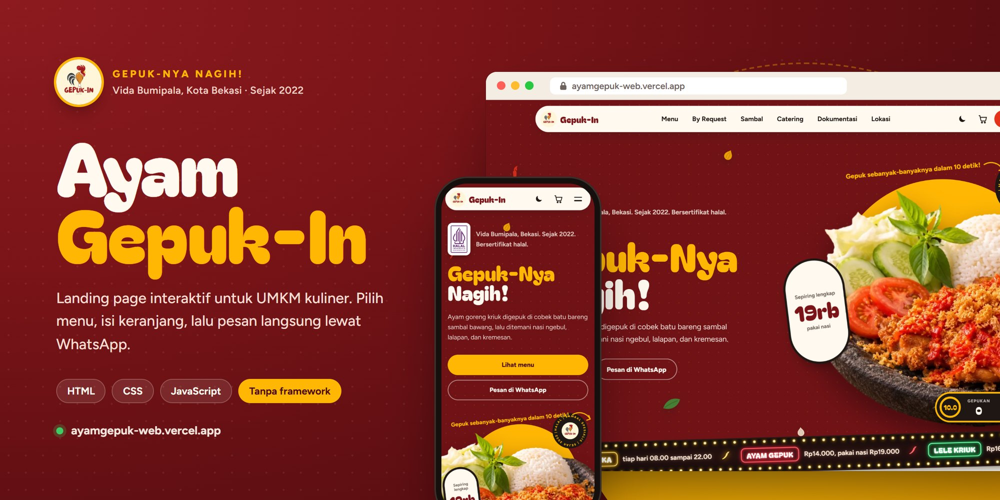
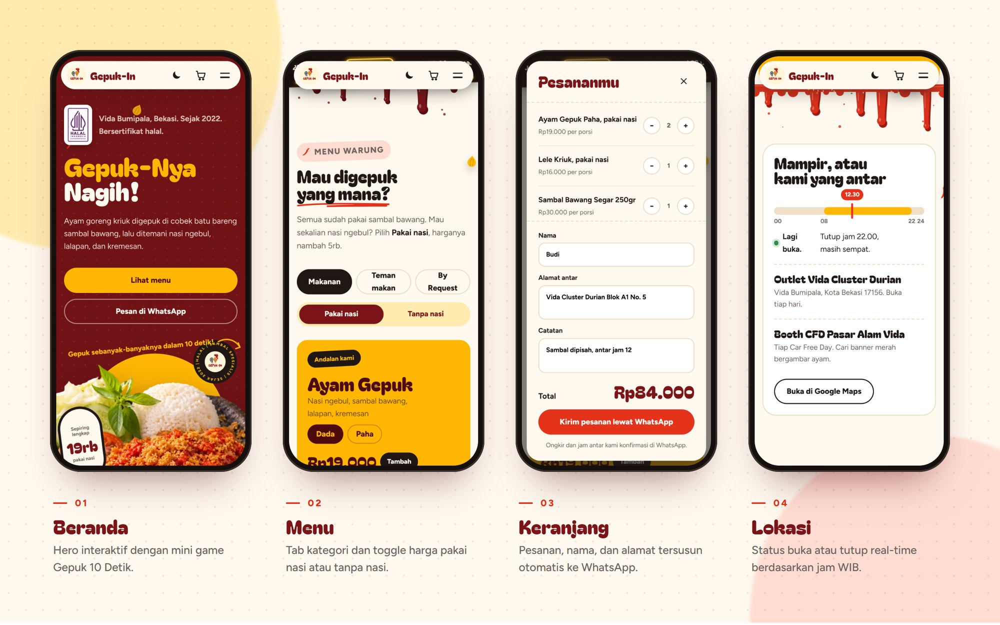
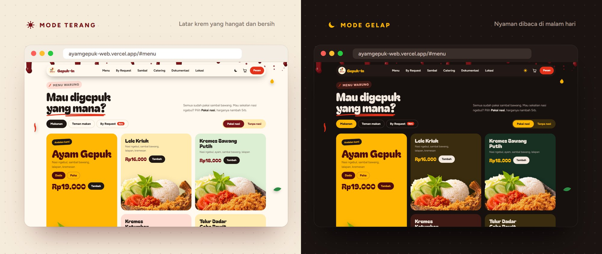
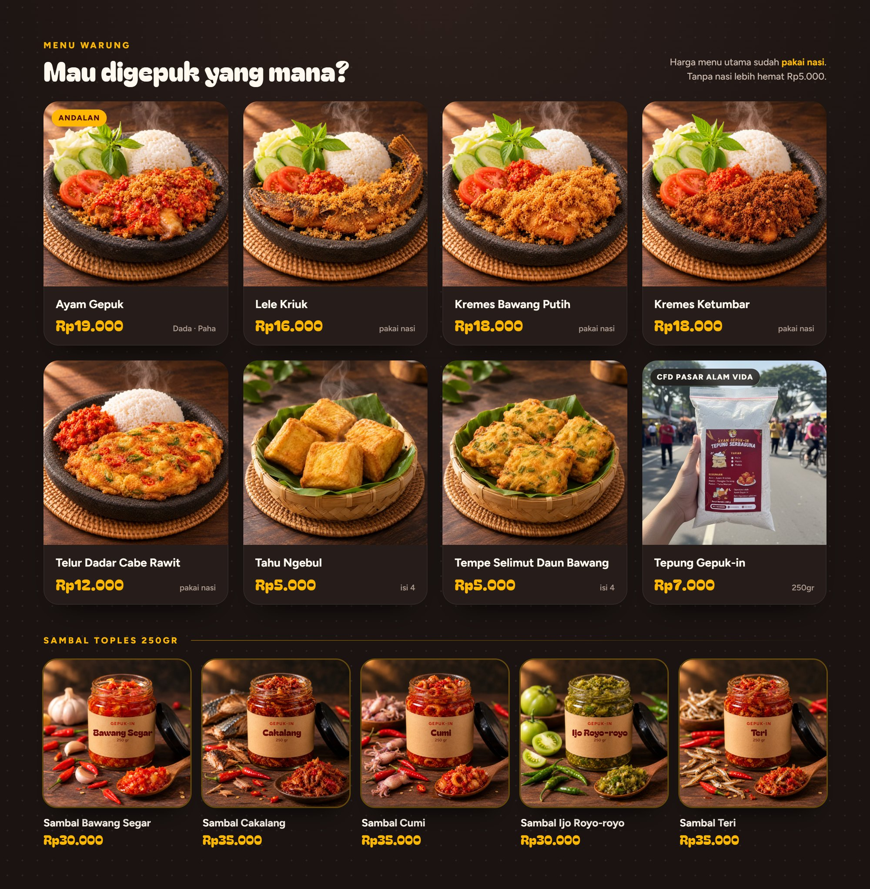
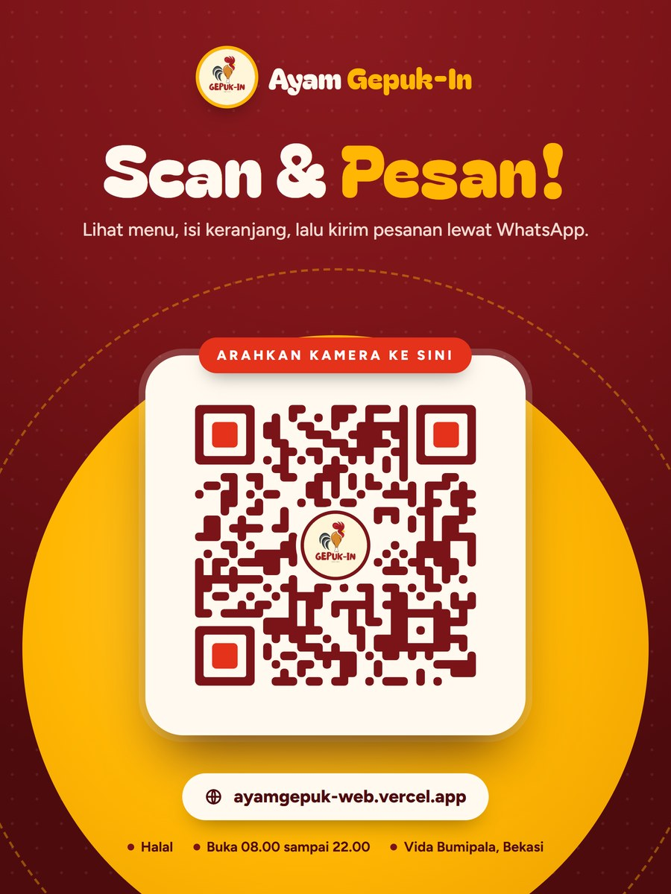
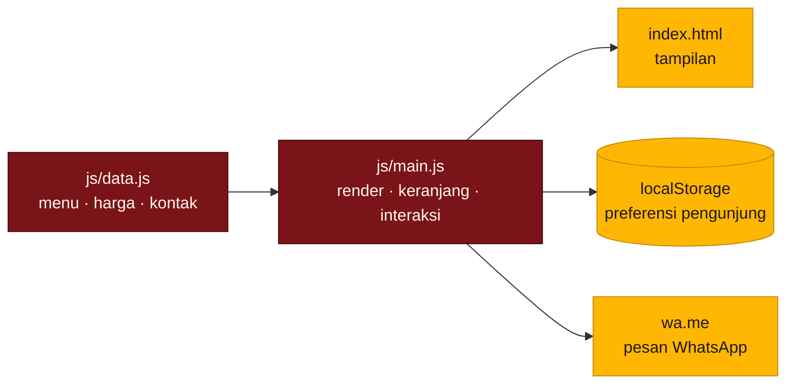
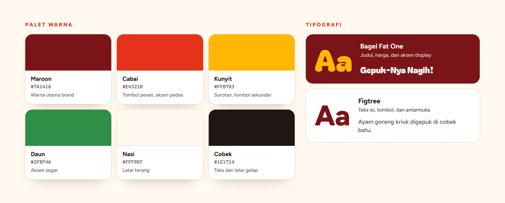
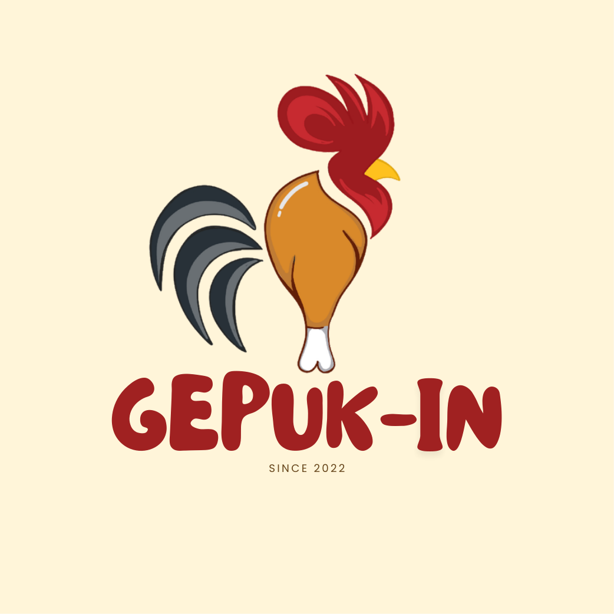

<a href="https://ayamgepuk-web.vercel.app/">
  
</a>

<p align="center">
  <a href="https://ayamgepuk-web.vercel.app/"></a>
</p>

<p align="center">
  
  
  
  
  
</p>

<p align="center">
  <a href="#tentang">Tentang</a> &nbsp;·&nbsp;
  <a href="#tampilan">Tampilan</a> &nbsp;·&nbsp;
  <a href="#fitur">Fitur</a> &nbsp;·&nbsp;
  <a href="#menu">Menu</a> &nbsp;·&nbsp;
  <a href="#qr-code">QR Code</a> &nbsp;·&nbsp;
  <a href="#menjalankan-secara-lokal">Instalasi</a> &nbsp;·&nbsp;
  <a href="#mengelola-konten">Kelola Konten</a> &nbsp;·&nbsp;
  <a href="PRD.md">PRD</a>
</p>

## Tentang

**Ayam Gepuk-In** adalah warung ayam gepuk dan sambal spesialis di Vida Bumipala, Kota Bekasi, yang berdiri sejak 2022. Sebagian besar pelanggannya datang dari Instagram dan memesan lewat WhatsApp.

Website ini dibangun untuk satu tujuan: **membuat pengunjung bisa memesan dengan klik sesedikit mungkin.** Pengunjung cukup memilih menu dan mengisi keranjang. Pesanannya lalu tersusun otomatis menjadi pesan WhatsApp yang siap dikirim ke penjual.

- **Satu halaman, nol dependensi.** HTML, CSS, dan JavaScript murni, tanpa framework dan tanpa build step.
- **Tanpa backend.** Pemesanan berjalan sepenuhnya lewat WhatsApp, jadi tidak perlu server, database, atau akun.
- **Konten terpusat.** Menu, harga, kontak, dan jam buka dikelola dari satu file, [`js/data.js`](js/data.js).

## Tampilan





## Fitur

**Pemesanan**

- **Keranjang belanja** dengan total otomatis. Isinya tetap tersimpan walau halaman ditutup, dan harganya otomatis mengikuti data menu terbaru.
- **Checkout ke WhatsApp.** Isi keranjang, nama, alamat antar, dan catatan disusun menjadi satu pesan siap kirim.
- **Toggle *Pakai nasi / Tanpa nasi*** yang mengganti seluruh harga menu utama sekaligus.
- **Varian dan pesanan khusus:** pilihan Dada atau Paha, menu *by request* (nasi kuning, tumpeng, nasi liwet), dan catering tanpa minimal order.
- **Tiga kanal pemesanan:** WhatsApp, GoFood, dan ShopeeFood.

**Interaksi**

- **Mini game *Gepuk 10 Detik*** di bagian hero, lengkap dengan penghitung skor dan rekor.
- **Status buka / tutup real-time** yang dihitung dari jam WIB.
- **Ticker neon, galeri dokumentasi dengan lightbox,** dan soundtrack yang bisa dinyalakan atau dimatikan.

**Kualitas**

- **Mode gelap** yang mengikuti pengaturan perangkat dan bisa diganti manual.
- **Mobile-first**, karena mayoritas pengunjung membuka website dari Instagram.
- **Aksesibel:** fokus keyboard terlihat, label ARIA pada elemen interaktif, dan animasi dikurangi untuk pengguna `prefers-reduced-motion`.
- **Siap dibagikan:** meta Open Graph dan Twitter Card untuk pratinjau tautan yang rapi.

### Alur pemesanan

1. Pengunjung memilih menu beserta variannya, lalu menekan **Tambah**.
2. Keranjang menghitung total, lalu pengunjung mengisi nama, alamat antar, dan catatan.
3. Tombol **Kirim pesanan lewat WhatsApp** membuka `wa.me` dengan pesan yang sudah tersusun.
4. Penjual mengonfirmasi ongkir dan jam antar di WhatsApp.

```text
Halo Ayam Gepuk-In, saya mau pesan:
- 2x Ayam Gepuk Paha, pakai nasi (Rp38.000)
- 1x Lele Kriuk, pakai nasi (Rp16.000)
- 1x Sambal Bawang Segar 250gr (Rp30.000)

Total: Rp84.000
Nama: Budi
Alamat: Vida Cluster Durian Blok A1 No. 5
Catatan: Sambal dipisah, antar jam 12
```

Baris Nama, Alamat, dan Catatan hanya muncul jika diisi, jadi pelanggan yang ambil sendiri cukup mengosongkan alamat.

## Menu



<details>
<summary><b>Daftar harga lengkap</b></summary>
<br>

| Menu | Pakai nasi | Tanpa nasi |
| :--- | ---: | ---: |
| Ayam Gepuk (Dada atau Paha) | Rp19.000 | Rp14.000 |
| Lele Kriuk | Rp16.000 | Rp11.000 |
| Ayam Kremes Bawang Putih | Rp18.000 | Rp13.000 |
| Ayam Kremes Ketumbar | Rp18.000 | Rp13.000 |
| Telur Dadar Cabe Rawit | Rp12.000 | Rp7.000 |

| Produk lain | Harga |
| :--- | ---: |
| Tahu Ngebul / Tempe Selimut Daun Bawang (isi 4) | Rp5.000 |
| Sambal Bawang Segar / Ijo Royo-royo (250gr) | Rp30.000 |
| Sambal Cakalang / Cumi / Teri (250gr) | Rp35.000 |
| Tepung Gepuk-in (250gr) | Rp7.000 |

Sumber data harga ada di [`js/data.js`](js/data.js). Jika ada perbedaan, file tersebut yang menjadi acuan.

</details>

## QR Code

<p align="center">
  
</p>

QR code mengarah ke [ayamgepuk-web.vercel.app](https://ayamgepuk-web.vercel.app/) dan dibuat dengan tingkat koreksi kesalahan tertinggi (H), sehingga tetap terbaca meski ada logo di tengahnya. Semua file ada di [`assets/qr/`](assets/qr/).

| File | Ukuran | Kegunaan |
| :--- | :--- | :--- |
| [`qr-ayamgepuk-poster.png`](assets/qr/qr-ayamgepuk-poster.png) | 1800 × 2400 px | Poster siap cetak untuk meja, etalase, atau booth CFD |
| [`qr-ayamgepuk.png`](assets/qr/qr-ayamgepuk.png) | 2048 × 2048 px | QR saja, untuk ditempel di desain lain |
| [`qr-ayamgepuk.svg`](assets/qr/qr-ayamgepuk.svg) | Vektor | Tetap tajam di ukuran cetak berapa pun, termasuk spanduk |

> [!TIP]
> Saat mencetak, beri jarak kosong di sekeliling QR dan pastikan lebarnya minimal 2,5 cm agar mudah dipindai.

## Teknologi

| Lapisan | Teknologi |
| :--- | :--- |
| Struktur | HTML5 semantik dengan atribut ARIA |
| Tampilan | CSS3: custom properties, Grid, Flexbox, container queries, animasi |
| Logika | JavaScript modern (ES2020), tanpa library |
| Tipografi | Bagel Fat One dan Figtree dari Google Fonts |
| Aset | Foto WebP, *lazy loading* untuk gambar di bawah layar |
| Hosting | Vercel (situs statis) |

Seluruh konten dirender dari satu sumber data. `main.js` membaca `data.js`, membangun tampilan di `index.html`, menyimpan preferensi pengunjung di browser, dan meneruskan pesanan ke WhatsApp.



<details>
<summary><b>Data yang disimpan di browser pengunjung</b></summary>
<br>

| Key | Isi |
| :--- | :--- |
| `agi-cart` | Isi keranjang belanja |
| `agi-theme` | Pilihan tema, `light` atau `dark` |
| `agi-best` | Rekor mini game Gepuk 10 Detik |
| `agi-music` | Preferensi lagu latar, `on` atau `off` |

Tidak ada data yang dikirim ke server. Pesanan baru keluar dari browser saat pengunjung menekan tombol kirim ke WhatsApp.

</details>

## Struktur Proyek

```text
AyamGepuk-Web/
├── index.html          Kerangka halaman (satu halaman)
├── css/
│   └── style.css       Styling, tema gelap, dan animasi
├── js/
│   ├── data.js         Sumber data: kontak, jam buka, menu, harga, ticker, dokumentasi
│   └── main.js         Render konten, keranjang, checkout WhatsApp, mini game, interaksi
├── assets/
│   ├── img/
│   │   ├── cut/        Foto menu berlatar transparan
│   │   ├── menu/       Foto produk, sambal, dan hero
│   │   └── doc/        Dokumentasi pesanan dan catering
│   ├── qr/             QR code website: poster, PNG, dan SVG
│   └── lagu/           Soundtrack Ayam Gepuk-In
├── .github/readme/     Gambar untuk README
└── PRD.md              Dokumen kebutuhan produk
```

## Menjalankan Secara Lokal

Tidak ada yang perlu di-install. Cukup browser modern, ditambah Node.js atau Python jika ingin memakai server lokal.

```bash
git clone https://github.com/Naufal-Ghani22/AyamGepuk-Web.git
cd AyamGepuk-Web

npx serve .                  # buka http://localhost:3000
# atau
python -m http.server 8000   # buka http://localhost:8000
```

> [!TIP]
> `index.html` juga bisa langsung dibuka di browser. Server lokal tetap disarankan agar perilakunya sama dengan versi online.

## Mengelola Konten

Semua konten yang sering berubah ada di [`js/data.js`](js/data.js), sehingga HTML tidak perlu disentuh.

| Yang ingin diubah | Lokasi | Catatan |
| :--- | :--- | :--- |
| Nomor WhatsApp | `CONFIG.wa` | Format internasional tanpa `+`, contoh `6285692061476` |
| Jam buka dan tutup | `CONFIG.open`, `CONFIG.close` | Format 24 jam, zona WIB |
| Tautan GoFood, ShopeeFood, Maps, Instagram | `CONFIG` | |
| Menu dan harga | `MENU.makanan`, `MENU.pendamping` | Harga dalam ribuan: `18` berarti Rp18.000 |
| Sambal dan tepung | `MENU.sambal`, `MENU.tepung` | |
| Menu *by request* | `MENU.byreq` | Tanpa harga, dikonfirmasi lewat WhatsApp |
| Produk segera hadir | `MENU.soon` | |
| Teks ticker | `TICKER.atas` | Warna neon: `merah`, `kuning`, atau `hijau` |
| Foto dokumentasi | `DOK` | |

Contoh menambah menu baru di `MENU.makanan`:

```js
{ id: "ayam-bakar", name: "Ayam Bakar", desc: "Sambal bawang, lalapan", paket: 20, ala: 15 },
```

Simpan fotonya sebagai `assets/img/cut/ayam-bakar.webp`, dengan nama file yang sama seperti `id`.

> [!NOTE]
> Setelah mengganti foto menu, naikkan angka versi `?v=4` pada fungsi `cut` di [`js/main.js`](js/main.js) agar browser pengunjung tidak menampilkan foto lama dari cache.

## Deploy

Situs ini statis, jadi bisa di-host di mana saja tanpa build step.

| Platform | Pengaturan |
| :--- | :--- |
| Vercel | Import repositori, pilih preset *Other*, kosongkan build command |
| Netlify | Publish directory `./`, tanpa build command |
| GitHub Pages | Settings → Pages → deploy dari branch `main`, folder root |

> [!IMPORTANT]
> Meta `og:url` dan `og:image` di `index.html`, juga QR code di `assets/qr/`, mengarah ke `ayamgepuk-web.vercel.app`. Perbarui semuanya jika domain berubah agar pratinjau tautan dan QR code tetap mengarah ke alamat yang benar.

## Identitas Visual



Palet warna diambil dari bahan masakan dan logo Ayam Gepuk-In. Semua warna didefinisikan sebagai CSS custom properties di [`css/style.css`](css/style.css).

## Rencana Pengembangan

- [ ] Ganti tautan Google Maps dengan titik lokasi outlet yang sebenarnya.
- [ ] Rilis produk yang sedang disiapkan: Lem Kuning, Ayam Gepuk Frozen, Tepung Marinasi, dan Ayam Goreng Lengkuas.

Pembayaran online, login, dan panel admin berada di luar lingkup versi ini. Rincian kebutuhan produk ada di [`PRD.md`](PRD.md).

## Hak Cipta

Logo, foto produk, foto dokumentasi, dan soundtrack adalah aset merek milik Ayam Gepuk-In dan tidak untuk digunakan ulang tanpa izin.

---

<p align="center">
  
</p>

<p align="center">
  <b>Ayam Gepuk-In</b> · Vida Bumipala, Kota Bekasi · Buka setiap hari 08.00–22.00
  <br>
  <a href="https://ayamgepuk-web.vercel.app/">Website</a> &nbsp;·&nbsp;
  <a href="https://instagram.com/ayamgepuk.in">Instagram</a> &nbsp;·&nbsp;
  <a href="https://wa.me/6285692061476">WhatsApp</a>
  <br>
  <sub>Dirancang dan dikembangkan oleh <a href="https://github.com/Naufal-Ghani22">Naufal-Ghani22</a></sub>
</p>
